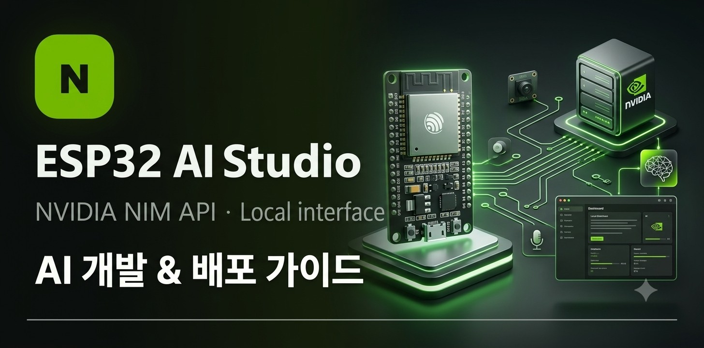
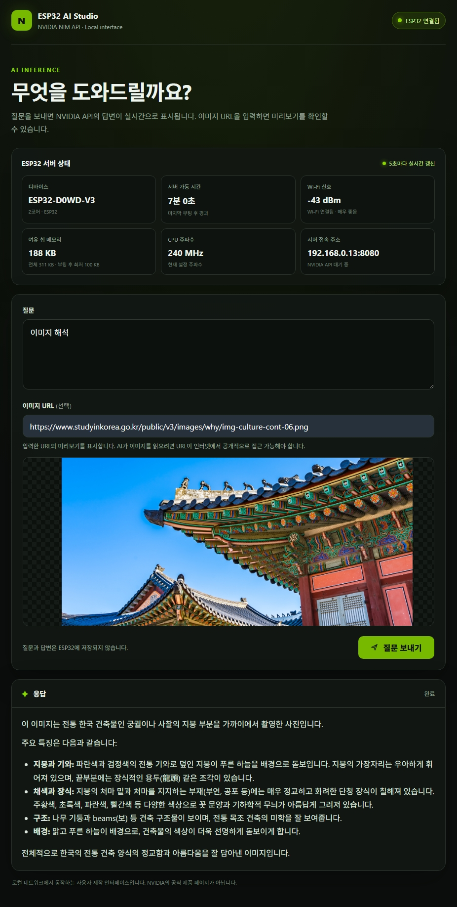

# ESP32 AI Studio



ESP32를 Wi-Fi에 연결해 로컬 네트워크용 AI 질의응답 웹 인터페이스를 제공하는 프로젝트입니다.

스마트폰이나 PC 브라우저에서 ESP32 웹페이지에 접속하여 텍스트 질문과 이미지 URL을 전송하면, ESP32가 NVIDIA NIM API에 요청하고 스트리밍 방식으로 전달받은 AI 답변을 실시간으로 화면에 표시합니다.

## 실행 화면



ESP32에서 제공하는 웹 인터페이스로, 별도의 애플리케이션 설치 없이 같은 내부 네트워크에 연결된 브라우저에서 사용할 수 있습니다.

### 주요 UI 구성

| 구성 요소 | 설명 |
|---|---|
| 연결 상태 | ESP32 WebSocket 연결 상태 표시 |
| 질문 입력 | 최대 3,000자의 텍스트 질문 입력 |
| 이미지 URL | 이미지 분석을 위한 URL 입력 |
| 이미지 미리보기 | 입력한 이미지 URL을 브라우저에서 미리보기 |
| 질문 보내기 | NVIDIA NIM API에 질의 요청 |
| 실시간 응답 | AI 답변을 스트리밍 방식으로 출력 |
| 응답 상태 | 대기, 생성 중, 완료, 오류 상태 표시 |

### UI 디자인 특징

- NVIDIA Green 계열의 포인트 컬러를 활용한 다크 테마
- 카드 기반의 입력 및 응답 레이아웃
- PC와 모바일 환경을 지원하는 반응형 디자인
- Markdown 기반의 답변 렌더링
- 응답 생성 중 타이핑 커서 애니메이션
- WebSocket 연결 상태에 따른 버튼 활성화 및 비활성화

## 주요 기능

- **로컬 웹 인터페이스**: ESP32에서 직접 HTML 페이지 제공
- **mDNS 접속**: `http://esp32-ai.local`을 통한 내부망 접근
- **텍스트 질의**: 사용자 질문을 NVIDIA NIM API로 전달
- **이미지 질의**: 이미지 URL을 포함한 멀티모달 요청 지원
- **이미지 미리보기**: 브라우저에서 입력한 이미지 URL 확인
- **실시간 스트리밍**: NVIDIA API의 SSE 응답을 WebSocket으로 브라우저에 전달
- **비동기 처리**: FreeRTOS Task를 활용한 AI API 요청 처리
- **메모리 기반 처리**: 질문과 응답을 ESP32 플래시에 영구 저장하지 않음
- **동시 요청 제한**: AI 요청을 한 번에 하나씩 처리하여 메모리 사용량 관리

## 시스템 아키텍처

```text
┌─────────────────────────────────────┐
│           User Browser              │
│                                     │
│  HTML / CSS / JavaScript            │
│  - Question Input                   │
│  - Image URL Preview                │
│  - Markdown Renderer                │
│  - WebSocket Client                 │
└──────────────────┬──────────────────┘
                   │
             HTTP : 80
             WebSocket : 81
                   │
┌──────────────────▼──────────────────┐
│              ESP32                  │
│                                     │
│  ┌───────────────────────────────┐  │
│  │       HTTP Web Server         │  │
│  │       WebSocket Server        │  │
│  └───────────────────────────────┘  │
│                                     │
│  ┌───────────────────────────────┐  │
│  │       Request Handler         │  │
│  │       FreeRTOS Task           │  │
│  └───────────────────────────────┘  │
│                                     │
│  ┌───────────────────────────────┐  │
│  │       Stream Message Queue    │  │
│  │       RAM Buffer              │  │
│  └───────────────────────────────┘  │
└──────────────────┬──────────────────┘
                   │
                HTTPS
                   │
┌──────────────────▼──────────────────┐
│           NVIDIA NIM API            │
│                                     │
│  Model:                             │
│  nemotron-3.5-super-vl-120b-a12b    │
│                                     │
│  Server-Sent Events (SSE)           │
│  Streaming Response                 │
└─────────────────────────────────────┘
```

## 질의응답 처리 과정

1. 사용자가 브라우저에서 질문과 선택적 이미지 URL을 입력합니다.
2. JavaScript가 질문 데이터를 JSON 형식으로 변환합니다.
3. WebSocket을 통해 ESP32에 요청을 전달합니다.
4. ESP32가 요청을 검증하고 FreeRTOS Task를 생성합니다.
5. 별도의 Task에서 NVIDIA NIM API에 HTTPS 요청을 전송합니다.
6. NVIDIA API의 SSE 스트리밍 응답을 수신합니다.
7. 수신한 응답을 JSON으로 파싱하고 텍스트 조각으로 분리합니다.
8. FreeRTOS Queue를 통해 메인 `loop()`에 전달합니다.
9. ESP32가 WebSocket을 통해 브라우저에 답변을 실시간으로 전송합니다.
10. 브라우저가 Markdown을 렌더링하여 최종 답변을 표시합니다.

## 프로젝트 구조

```text
ESP32-AI-Studio/
│
├── NIM.ino          # ESP32 메인 펌웨어 및 API 처리
├── include/
│   ├── page.h       # HTML / CSS / JavaScript 웹 인터페이스
│   ├── secrets.example.h # 설정 파일 예시
│   └── secrets.h    # 로컬 Wi-Fi 및 NVIDIA API 설정 (Git 제외)
├── static/
│   └── title.jpeg   # README 실행 화면 이미지
├── .gitignore       # 민감한 설정 파일 제외
└── README.md
```

## 개발 환경 및 준비물

### 하드웨어

- ESP32 보드 및 USB 케이블
- Wi-Fi 네트워크

### 소프트웨어

- Arduino IDE
- ESP32 Arduino Core
- ArduinoJson 라이브러리
- WebSockets 라이브러리 (`WebSocketsServer` 지원)

### 외부 API

- NVIDIA NIM API
- NVIDIA API Key

사용 모델:

```text
nvidia/nemotron-3.5-super-vl-120b-a12b
```

## 설정 및 업로드

### 1. 프로젝트 파일 구성

`NIM.ino`와 `include`, `static` 폴더를 함께 유지합니다. 로컬 설정 파일은 `include` 폴더에 둡니다.

```text
NIM.ino
include/page.h
include/secrets.example.h
include/secrets.h
static/title.jpeg
```

### 2. API 및 Wi-Fi 설정

`include/secrets.example.h`를 복사해 `include/secrets.h`를 만들고 실제 값을 설정합니다. `include/secrets.h`는 `.gitignore`에 의해 Git에 포함되지 않습니다.

```cpp
const char* WIFI_SSID = "YOUR_WIFI_SSID";
const char* WIFI_PASSWORD = "YOUR_WIFI_PASSWORD";

const char* NVIDIA_API_KEY = "YOUR_NVIDIA_API_KEY";

const char* NVIDIA_API_URL =
    "https://integrate.api.nvidia.com/v1/chat/completions";

const char* NVIDIA_MODEL =
    "nvidia/nemotron-3.5-super-vl-120b-a12b";
```

### 3. 펌웨어 업로드

1. Arduino IDE에서 ESP32 보드와 포트를 선택합니다.
2. `NIM.ino`를 엽니다.
3. 필요한 라이브러리가 설치되어 있는지 확인합니다.
4. ESP32에 스케치를 업로드합니다.

### 4. 웹페이지 접속

시리얼 모니터를 `115200 baud`로 설정합니다.

Wi-Fi 연결이 완료되면 ESP32의 IP 주소와 mDNS 주소가 출력됩니다.

```text
웹페이지 주소: http://esp32-ai.local
웹서버 시작: HTTP 80, WebSocket 81
```

같은 로컬 네트워크에 연결된 PC 또는 스마트폰 브라우저에서 접속합니다.

```text
http://esp32-ai.local
```

mDNS를 지원하지 않는 환경에서는 시리얼 모니터에 출력된 IP 주소를 사용합니다.

## 데이터 및 메모리 관리

이 프로젝트는 ESP32의 플래시 메모리에 질문 및 답변을 영구 저장하지 않는 방식으로 동작합니다.

- 질문과 이미지 URL은 RAM의 임시 변수로 관리합니다.
- 스트리밍 응답은 FreeRTOS Queue를 통해 전달합니다.
- AI 응답은 브라우저에서 실시간으로 출력합니다.
- 별도의 대화 기록 데이터베이스를 사용하지 않습니다.
- ESP32 재부팅 후 이전 질의응답을 복구하지 않습니다.

단, 현재 구현은 질문 및 이미지 URL을 전역 `String` 변수에 보관하므로 요청 종료 직후 해당 RAM 데이터가 명시적으로 삭제되는 구조는 아닙니다.

## 보안 및 네트워크 참고

- `secrets.h`에는 Wi-Fi 비밀번호와 NVIDIA API 키가 포함됩니다. Git 저장소에 업로드하지 않도록 `.gitignore`에 등록해야 합니다.
- API 키는 ESP32 펌웨어에 포함되므로 펌웨어를 확보한 사용자가 추출할 가능성이 있습니다.
- 현재 HTTPS 통신에는 `client.setInsecure()`가 적용되어 서버 인증서를 검증하지 않습니다. 실제 배포 시에는 CA 인증서 검증을 설정해야 합니다.
- 웹 인터페이스는 별도의 로그인 없이 로컬 네트워크에서 접근할 수 있으므로 신뢰할 수 있는 네트워크에서만 사용해야 합니다.
- 이미지 URL은 브라우저 미리보기와 NVIDIA API의 이미지 접근이 각각 가능해야 합니다. NVIDIA API가 접근할 수 없는 내부망 전용 이미지 주소는 분석할 수 없습니다.
- 현재 구현은 한 번에 하나의 AI 요청만 처리합니다.

## 기술 스택

| 영역 | 기술 |
|---|---|
| MCU | ESP32 |
| Firmware | Arduino Framework |
| Network | Wi-Fi / mDNS |
| HTTP Server | ESP32 WebServer |
| WebSocket | WebSocketsServer |
| Task Management | FreeRTOS |
| API Communication | HTTPS / HTTPClient |
| JSON Processing | ArduinoJson |
| AI Inference | NVIDIA NIM API |
| Frontend | HTML5 / CSS3 / JavaScript |
| Markdown | marked.js |
| HTML Sanitization | DOMPurify |

## License

개인 학습 및 개발 목적으로 제작한 프로젝트입니다.